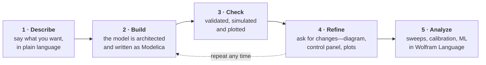
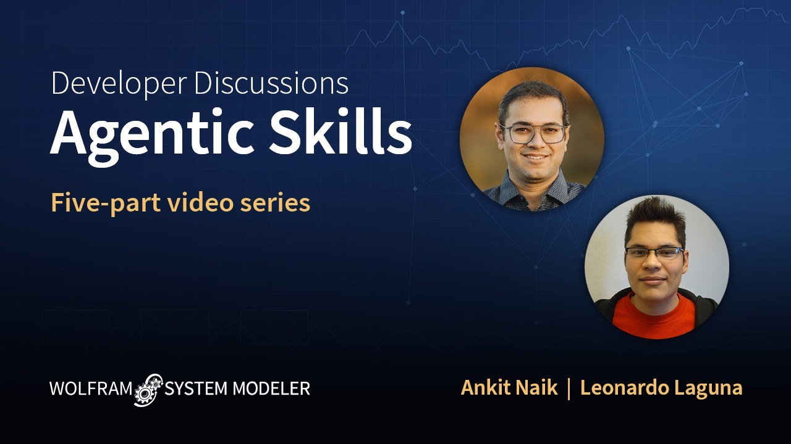

<div align="center">

# Wolfram System Modeler Skills

**Teach your AI coding assistant to build, simulate and debug
[Wolfram System Modeler](https://www.wolfram.com/system-modeler/) models.**

[](LICENSE)
[](https://www.wolfram.com/system-modeler/)


[**Download a free 30-day System Modeler trial →**](https://www.wolfram.com/system-modeler/trial/)

</div>

https://github.com/user-attachments/assets/36dd8e4c-43e3-44ef-a11c-6292908003bd

A bundle of skills that let an AI coding assistant—[**Claude Code**](https://claude.com/claude-code),
[**OpenAI Codex**](https://openai.com/codex/) or any LLM agent with
command-line access—work with
[Wolfram System Modeler](https://www.wolfram.com/system-modeler/) (and
[Modelica](https://www.wolfram.com/system-modeler/resources/what-is-modelica/)).
A *skill* is simply a folder of instructions and tools that the assistant reads
and runs on your behalf.

The skills **create, validate, simulate, diagnose, plot, animate and document** models,
and **post-process** results with Wolfram Language. They also look up answers
from the Modelica and System Modeler documentation.

Compiling and simulating run on System Modeler's kernel—but the models the
skills write are standard Modelica `.mo` files you can open in any Modelica tool.

> [!TIP]
> **New to Modelica?** It's the open modeling language that System Modeler is built
> on—the textual form behind the drag-and-drop diagrams, stored in `.mo` files.
> These skills read and write that text, so your assistant can build and check
> models as code. See [What Is Modelica?](https://www.wolfram.com/system-modeler/resources/what-is-modelica/)
> for a short introduction.

## What's inside

| Capability | What the assistant does |
|---|---|
| **Architect** | Decide component decomposition, connectors and structure before writing equations |
| **Create** | Write a Modelica model from a plain-language description |
| **Validate & simulate** | Check that a model compiles, then run it |
| **Run live** | Run a model in real time and change its inputs and parameters while it runs, from the command line, a live plot or your own program |
| **Diagnose** | Explain why a model is slow or failing |
| **Report compiler bugs** | Shrink a model that triggers a System Modeler internal error to a minimal reproduction, ready to send to Wolfram support |
| **Plot** | Plot simulation results and store those plots back inside the model |
| **Search the docs** | Answer from the Modelica Language Specification and the System Modeler documentation, with cited sources (works offline) |
| **Annotate** | Turn a text-only model into a proper schematic |
| **Add control panels** | Add interactive sliders, checkboxes and menus for tuning parameters in the Explore view of Simulation Center (System Modeler's simulation GUI) |
| **Post-process** | Run parameter sweeps, calibration and ML on simulation results in Wolfram Language |

## How it works

Describe what you want, get a checked model back, then refine and analyze—all
in plain language. The modeling, compiling and simulating run for you.



The skills run on your machine, against your own System Modeler and Wolfram
Language installation. The one download is a set of Python packages from PyPI,
fetched the first time a plotting or analysis script runs.

## Get started

| Your assistant | Route |
|---|---|
| Claude Code or Claude Desktop | [Install the plugin](#claude-code-and-claude-desktop) |
| Codex or any other assistant | [Use the folder](#codex-and-other-assistants) |

The assistant sets the skills up for your environment and checks the
requirements—for the simulation features, **Wolfram System Modeler**
([free 30-day trial](https://www.wolfram.com/system-modeler/trial/)) plus a C++
compiler; for post-processing, **Wolfram Language** connected to the assistant
via the
[Wolfram Local MCP](https://www.wolfram.com/artificial-intelligence/mcp/local/);
and Python 3 for scripting.

### Claude Code and Claude Desktop

1. In a Claude Code or Claude Desktop session, run:
   ```
   /plugin marketplace add WolframResearch/system-modeler-ai-toolkit
   ```
2. Then run:
   ```
   /plugin install system-modeler@wolfram-system-modeler
   ```
3. Start a new session so the skills load, and ask:

   > "Check that this machine is ready to validate and simulate System Modeler
   > models."

### Codex and other assistants

1. Clone this repository or download it as a ZIP (*Code → Download ZIP* on
   GitHub) and uncompress it. Keep it as one folder; don't move the pieces
   apart. To update later, `git pull` (or redownload).
2. Start your assistant in that folder so it can read the files and run
   commands: in a terminal, open the folder and start the assistant there (run
   `codex` for Codex); in a desktop app, choose the folder as the session's
   project folder.
3. Ask:

   > "Read `InstallationGuide.md` in this folder and install these skills for me."

   The assistant sets the skills up for your environment and checks your setup.

On either route the assistant flags anything missing; just follow its prompts.

### Try it out

Ask for something real, for example:

> "Create a hydraulic circuit with a pump and a double-acting cylinder, then
> validate it to check that it compiles."

> "What's new in Wolfram System Modeler 15?"

The assistant will use the relevant skills to build, check and explain—citing
its sources where it looked things up.

> [!NOTE]
> Curious about exactly what each skill needs? It's all in
> [`InstallationGuide.md`](InstallationGuide.md), the guide your AI assistant
> reads to install and check the skills.

## Videos

<a href="https://www.youtube.com/playlist?list=PLDoLu2s-YHDY"></a>

**Developer Discussions: Agentic Skills** is a five-part video series in which
System Modeler developers Ankit Naik and Leonardo Laguna Ruiz use these skills
with Claude Code. Watch the
[full playlist on YouTube](https://www.youtube.com/playlist?list=PLDoLu2s-YHDY).

| Session | Topic |
|---|---|
| 1 | [Building models: four models in four domains](https://www.youtube.com/watch?v=wXld8l1mdIg&list=PLDoLu2s-YHDY) |
| 2 | [Analyzing models with the Wolfram MCP server: a gyroscopic monorail](https://www.youtube.com/watch?v=7eHo4IM1q3o&list=PLDoLu2s-YHDY) |
| 3 | [Connecting models to real-world applications](https://www.youtube.com/watch?v=eKq9EdMeBgs&list=PLDoLu2s-YHDY) |
| 4 | [Debugging slow models](https://www.youtube.com/watch?v=UR0YabxpYJQ&list=PLDoLu2s-YHDY) |
| 5 | [Sharing models through FMI](https://www.youtube.com/watch?v=O78MzUSZeVA&list=PLDoLu2s-YHDY) |

Questions, suggestions and your own results are welcome in the
[discussion on Wolfram Community](https://community.wolfram.com/t/youtube-series-developer-discussions-five-sessions-on-ai-agents-and-wolfram-system-modeler/28426).

## License

This product incorporates portions of the Modelica® Language Specification.

This project is licensed under the [MIT License](LICENSE), **except** for the
documentation bundled with `search-modelica-docs`:

- **Modelica Language Specification** excerpts (`docsearch/data/spec.json`)—licensed
  by the Modelica Association under
  [CC BY-SA 4.0](https://creativecommons.org/licenses/by-sa/4.0/) and
  distributed here under the same license
- **Modelica Standard Library** reference (`docsearch/data/msl.part1.json` + `msl.part2.json`)—©
  Modelica Association and contributors, under the
  [BSD 3-Clause License](https://github.com/modelica/ModelicaStandardLibrary/blob/master/LICENSE)
- **Wolfram System Modeler documentation** excerpts (`docsearch/data/docs.json`)—©
  Wolfram Research, Inc., Wolfram's own product documentation, distributed here
  by Wolfram; see
  [reference.wolfram.com/system-modeler](https://reference.wolfram.com/system-modeler/)
  for the original

See [`search-modelica-docs/ATTRIBUTION.md`](search-modelica-docs/ATTRIBUTION.md) for
full attribution, license texts and the ShareAlike obligation.

---

<div align="center">

Enjoy using the skills! 🛠️

</div>
